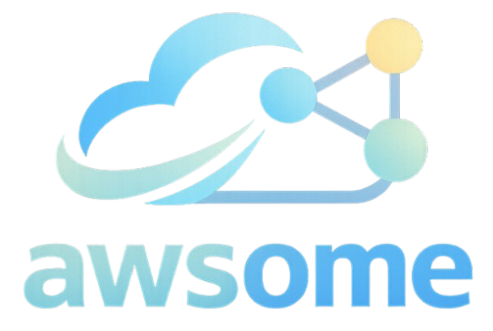

<p align="center">
  
</p>

# awsome

awsome is a Linux desktop app for inspecting regional AWS network inventory and sketching architecture plans. Live scans use read-only AWS APIs. Changes made in Planning mode stay on this device and are never applied to AWS.

The app uses an Electron shell, a Vite and React interface, and a Rust companion process. The Rust process reads the selected AWS profile, collects inventory, and returns graph data to the interface. Cytoscape renders the live topology.

## Live topology

Choose an AWS profile and up to 50 regions, then select **Scan AWS**. At most three regions are scanned at once. Search matches resource names, IDs, types, and returned details. Service-type and region filters narrow the graph without resetting its pan or zoom. Use the mouse wheel to zoom around the pointer, drag empty canvas space to pan, drag a resource toward a canvas edge to reveal more space, and use **Fit** to show the full graph. Short connection captions appear where they fit; hover over or select a connection to read its full label.

### Inventory coverage

Live discovery is limited to the regional resources below; it is not a complete inventory of every AWS service.

- **EC2 network inventory:** VPCs, subnets, EC2 instances, security groups, internet gateways, NAT gateways, egress-only internet gateways, gateway and interface VPC endpoints, VPC peering connections, route tables, Transit Gateways, Transit Gateway attachments and route tables, and discovered Transit Gateway routes.
- **RDS:** DB instances. The app does not query RDS cluster-level inventory.
- **Elastic Load Balancing v2:** Application and Network Load Balancers, listeners, listener default actions, custom rules and conditions, target groups, health-check settings, and registered instance, IP, Lambda, or ALB targets. Gateway Load Balancers are not included.

Relationships are derived from the returned configuration inventory; they do not represent observed traffic or test reachability. An edge is emitted only when both endpoint resources are present. A subnet without an explicit route-table association is associated with its VPC's main route table. Route paths through load balancers are shown as load balancer → listener → rule → target group → target; only forward actions create target-group routing edges.

If an inventory call fails, awsome keeps the resources it did discover and marks the affected inventory as incomplete. Successful regions remain available when another region fails. Comparisons omit scopes that were incomplete in either scan, so missing inventory is not counted as a confirmed deletion. A region whose primary inventory calls all fail is marked failed. If every selected region fails, the scan returns an error instead of an empty graph. After a failed refresh, the last successful graph remains visible with a previous-snapshot warning.

### Topology analysis

Choose **Analyze** from a live or offline scan to work with its full inventory.

- **Trace a path** finds a shortest chain of recorded relationships between two resources. Enable **Follow edge direction only** to constrain the search. **Open path in planner** imports the resources and edges along that chain.
- **Simulate removal** shows which resources lose their connection to a chosen anchor when one resource is omitted. It considers alternate connections in either direction and excludes resources already disconnected from the anchor. The result describes configuration relationships and does not predict traffic or outages.
- **Review plan coverage** compares the open architecture with the scan using imported resource identities, profile, and region. It lists scanned resources outside the plan, imported resources unseen in this scan, and manually designed services.

### Saved scans

Successful scans are saved on the device. **Open saved scan** works offline and keeps the profile and regions set for your next AWS scan. **Compare with canvas** compares two different scans that used the same profile and region set. Changes are reported from the earlier scan to the later scan. When you scan the same profile and region set again, awsome automatically compares the result with the most recent saved scan for that source.

The **Storage** control shows saved-scan disk use and previews the exact files that cleanup would remove. Cleanup keeps the selected number of newest scans per profile and region set, and rechecks the candidate list before deleting. Snapshot files contain resource inventory and metadata; protect the app data directory accordingly.

## Planning mode

Planning mode is a local architecture editor. Add services from the AWS service library, then use **Connect** and select the source and destination in order. You can click each service, drag from source to destination, or focus each service and press Enter. Use the details panel to label connections. Undo and redo are available for planning edits.

Planning documents autosave on this device and restore when the app starts. They include node names, positions, sizes, connections and their labels, and canvas zoom and pan. The architecture library supports multiple documents. Import and export use JSON documents with the `graphivo/planning-document` schema, version 1; **Export SVG** creates a self-contained diagram.

To make a plan from a live or saved scan, select **Plan from full scan**. This includes importable resources hidden by filters. When an existing architecture is open, **Create new architecture** keeps it in the library and creates a separate plan from the scan. You can also add to the current architecture, replace its canvas, or cancel. Adding to an existing plan skips resources and connections already imported from the same source. Imported nodes retain their source resource, profile, region, and provenance; editing the plan leaves the saved scan intact.

Invalid or unsupported JSON imports are rejected with an explanation. Importing a document whose ID already exists asks before replacing it. Deleting a saved architecture requires confirmation.

### Import a Terraform plan

In your Terraform project, save a plan and export its JSON:

```bash
terraform plan -out=topology.tfplan
terraform show -json topology.tfplan > topology.tfplan.json
```

In Planning mode, choose **File → Import JSON** and open `topology.tfplan.json`. The review lists counts and addresses for managed HashiCorp AWS resources, starting with deletions and replacements, followed by updates and creations. Both Terraform replacement orders count as replacements. The review includes resource types the planner cannot draw and excludes reads, no-ops, data resources, and changes from other providers.

Choose **Export change summary** to download `awsome-terraform-change-summary.json` while keeping the review open. It contains the summary format version, the incomplete flag, and the resource addresses in each action group. You can export even when there are no changes or no supported services to import. Resource addresses can include project-specific names.

When the proposed topology has supported services, choose **Import architecture** to save it as a new local architecture and keep your previous plan in the library. You can close a review without importing, including a deletion-only plan with an empty proposed topology. Select an imported service to see its Terraform address and resource type. Those fields are retained in awsome JSON exports.

The import uses the proposed state in Terraform plan JSON format 1.x. It supports common AWS network, compute, storage, database, messaging, and load-balancing resources from the HashiCorp AWS provider, including resources inside modules. Relationships between known planned IDs include VPC and subnet membership, security groups, standalone routes and route table associations, and load balancer listeners and targets. Edges marked **Terraform reference** show dependencies from configuration expressions whose planned values are unknown. An expression can reference several resources while evaluating to an ID elsewhere. Links through variables, module outputs, external resources, or ambiguous references may be absent. The importer reports unsupported AWS resource counts and plans marked incomplete.

Awsome reads the file locally and keeps the change review in memory until you close or import it. The saved architecture contains service addresses, types, and derived relationships. Terraform JSON may contain sensitive values, so protect the original file. The review and saved architecture omit raw attribute values and outputs, and the importer excludes sensitive relationship fields when drawing connections.

## AWS profiles and permissions

awsome lists profile names from the shared AWS config and credentials files. By default, it reads `~/.aws/config` and `~/.aws/credentials`; set `AWS_CONFIG_FILE` or `AWS_SHARED_CREDENTIALS_FILE` to use different files. The selected profile is passed to the AWS SDK for Rust. Live scans require credentials and read access for the selected profile. Planning mode and previously saved scans do not require AWS access.

The backend currently calls these AWS API operations:

- **EC2:** `DescribeRegions`, `DescribeVpcs`, `DescribeSubnets`, `DescribeInstances`, `DescribeSecurityGroups`, `DescribeInternetGateways`, `DescribeNatGateways`, `DescribeRouteTables`, `DescribeVpcEndpoints`, `DescribeVpcPeeringConnections`, `DescribeEgressOnlyInternetGateways`, `DescribeTransitGateways`, `DescribeTransitGatewayAttachments`, `DescribeTransitGatewayRouteTables`, and `SearchTransitGatewayRoutes`.
- **RDS:** `DescribeDBInstances`.
- **Elastic Load Balancing v2:** `DescribeLoadBalancers`, `DescribeTargetGroups`, `DescribeListeners`, `DescribeRules`, and `DescribeTargetHealth`.

The region picker is populated from regions returned by `DescribeRegions`. If the profile has no configured region, awsome uses `us-east-1` for that lookup. You can type a region code if the lookup is unavailable. Scans call AWS only for inventory; awsome does not create, update, or delete AWS resources.

## Local data

- Planning documents are stored in the Electron webview's local storage, inside the app's user-data directory. The library uses a versioned index and a separate entry for each architecture. The app can import the earlier `graphivo.planning.last-document` save without removing it.
- Scan snapshots and their summaries are stored as JSON in the app's data directory. On Linux, the default directory is `~/.local/share/com.basil.awsome.electron`, or `$XDG_DATA_HOME/com.basil.awsome.electron` when `XDG_DATA_HOME` is set.
- On first launch, Electron imports valid scans and planning documents from the previous Tauri installation. It leaves the original data in place, keeps an existing Electron entry when IDs conflict, and reports entries it cannot import.

If planning data is corrupt or incompatible, awsome isolates the unreadable entries and keeps valid architectures available. Export important plans as JSON backups.

## Development

Build from source with Node.js and npm, plus Rust stable and Cargo. The GitHub Actions workflow currently uses Node.js 22, Rust stable, and Ubuntu 22.04.

```bash
npm ci
npm run start
```

`npm run start` builds the Rust development companion, starts Vite on port `5173`, and opens the Electron app.

To build only the frontend, run `npm run build:web`. To create the production desktop package, run:

```bash
npm run build
```

The production build currently targets a Linux Debian package (`.deb`) and writes it under `release/`. It packages the Vite build and Rust companion; it does not start a development server.

### Checks

```bash
npm test
CARGO_TARGET_DIR=src-tauri/target CARGO_BUILD_JOBS=1 cargo test --manifest-path native/Cargo.toml --release --locked
cargo fmt --manifest-path native/Cargo.toml --all -- --check
```

The ignored live inventory smoke test requires read-only AWS access and at least two regions. Example using the `default` profile:

```bash
AWSOME_SMOKE_REGIONS=ap-southeast-1,ap-southeast-2 \
CARGO_TARGET_DIR=src-tauri/target \
cargo test --manifest-path native/Cargo.toml --locked tests::live_multi_region_inventory_smoke -- --ignored
```

Set `AWSOME_SMOKE_PROFILE` to use a different local profile. GitHub Actions runs the Node and Rust tests, checks Rust formatting, builds the `.deb`, opens the installed app in a virtual display, and uploads the package as a workflow artifact.

## Project layout

```text
src/                         Vite + React interface and planning logic
native/                      Rust AWS inventory and snapshot backend
electron/                    Electron main process and preload bridge
public/assets/               AWS service assets
src-tauri/                   Legacy Tauri sources and Rust build target directory
```

## License

awsome is licensed under the [MIT License](LICENSE).
